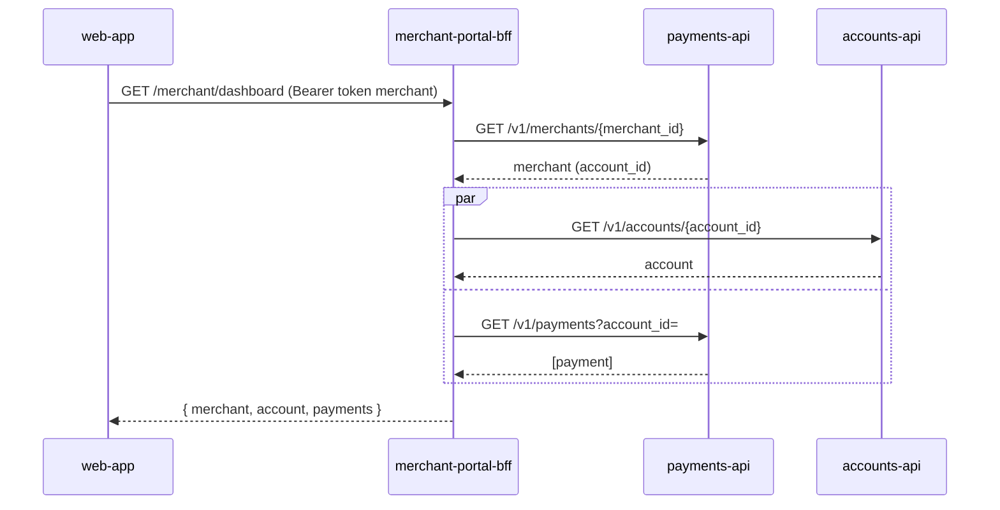

# merchant-portal-bff

BFF del portal de comercios. web-app le pega a esto, esto le pega a payments-api y a
accounts-api. No hay mucho más: no tenemos base propia, no publicamos eventos, no
llamamos vendors. Es la capa que arma el dashboard de un comercio y le deja cobrar.

Somos el equipo **channels**.

## Qué hace

Dos endpoints:

- `GET /merchant/dashboard`: junta el comercio (payments-api), su cuenta (accounts-api)
  y sus últimos cobros (payments-api) en una sola respuesta para que web-app no tenga
  que orquestar tres llamadas del lado del browser.
- `POST /merchant/charges`: cobra contra la cuenta del comercio (payments-api hace el
  trabajo pesado: fraude, ledger, todo eso; acá solo reenviamos con el `merchant_id`
  correcto).

El dato importante de todo esto es de dónde sale el `merchant_id`: **del claim
`merchant_id` del token**, no de ningún parámetro de la URL ni del body. El token lo
emite Keycloak para el client `merchant-portal` (el que usa la web-app) con el rol
`merchant`, y ese claim ya viene resuelto desde el login — un comercio no puede pedir
el dashboard de otro cambiando un id, porque acá nunca leemos un id que no sea el del
propio token.



Las llamadas salientes van con un token de servicio propio (client `merchant-portal-bff`,
credenciales client-credentials contra Keycloak) — nunca reenviamos el token del comercio
río abajo.

## Corriendo local

Necesitás Keycloak, payments-api y accounts-api accesibles (en el cluster de desarrollo
ya están en `platform`/`staging`). Con eso:

```bash
export SERVICE_NAME=merchant-portal-bff ENV=staging PORT=8080 LOG_LEVEL=info
export KEYCLOAK_ISSUER=http://localhost:8180/realms/cauri-staging
export KEYCLOAK_CLIENT_ID=merchant-portal-bff KEYCLOAK_CLIENT_SECRET=<secret del client>
export PAYMENTS_API_URL=http://localhost:8081 ACCOUNTS_API_URL=http://localhost:8082

npm install
npm run dev
```

No hay migraciones que correr ni base que levantar: este servicio no tiene una propia.

## Tests

```bash
npm test
```

`dashboard.test.ts` cubre el flujo feliz de `GET /merchant/dashboard` (agrega merchant,
cuenta y pagos con los clientes de payments-api/accounts-api mockeados), `POST
/merchant/charges`, validación de body y el 403 cuando el token no trae el rol
`merchant`. `auth.integration.test.ts` es distinto a propósito: no mockea
`createJwtAuth`, así que ejercita la lib real de `@cauri/commons` contra
`/merchant/dashboard` sin token y confirma que devuelve `401` con el envelope de error
de las convenciones internas de API — y que `/health` y `/metrics` siguen siendo públicos.

## Deployments

**No se deploya desde acá.** Es GitOps, estilo C: `build.yml` buildea la imagen, la
pushea a `ghcr.io/demo-org-np-migration/merchant-portal-bff` y bumpea el tag en el repo
`gitops` (`apps/merchant-portal-bff/values-staging.yaml` en cada push a `main`,
`values-prod.yaml` cuando taggeamos `v*`). Argo CD ve el cambio y sincroniza. Si algo no
levantó en el cluster, lo primero que hay que mirar es el estado de la app en Argo CD,
no este repo.

El chart vive en `chart/`. `chart/values.yaml` son los defaults de staging que usa Argo
como base; los valores reales de cada entorno están en `gitops/apps/merchant-portal-bff/`,
no acá. 1 réplica, `100m/128Mi` de requests — este servicio no hace nada pesado, solo
reenvía llamadas.

## Variables de entorno

`SERVICE_NAME`, `ENV`, `PORT`, `LOG_LEVEL`, `KEYCLOAK_ISSUER`,
`KEYCLOAK_CLIENT_ID=merchant-portal-bff`, `KEYCLOAK_CLIENT_SECRET`,
`PAYMENTS_API_URL=http://payments-api:8080`, `ACCOUNTS_API_URL=http://accounts-api:8080`.
Ver `chart/values.yaml` para los defaults y las convenciones internas de API para el detalle de
cada una.

## Librería compartida

Usamos `@cauri/commons` (`v1.2.1`) para logger, auth de JWT (`createJwtAuth`, rol
`merchant`), el token de servicio hacia payments-api/accounts-api
(`serviceTokenProvider`) y el cliente HTTP con reintentos (`httpClient`). El `/metrics`
lo servimos nosotros a mano con el `registry` de `metrics()`: su `handler()` es para
Express, no para Fastify.
